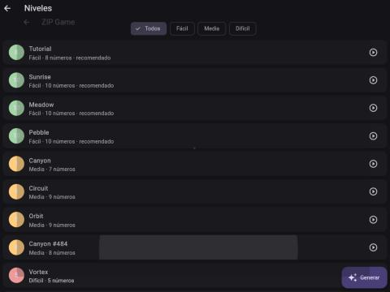
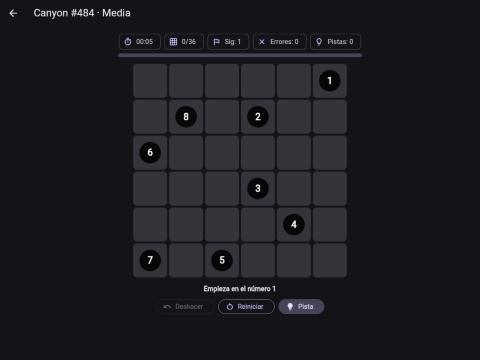
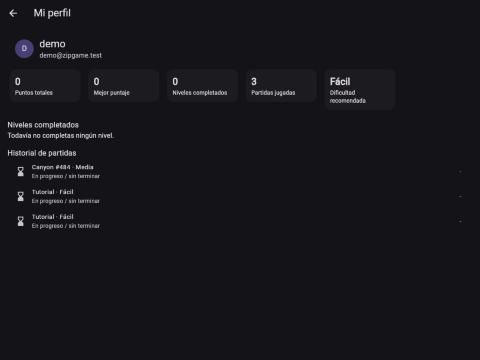

# zip-game

Flutter client (web and Android) for **ZIP Game**, a 6×6 logic puzzle: connect the numbers in ascending order with a single path that visits all 36 cells, with no diagonals and no repeated cells. It plays with mouse or touch and delegates validation, scoring and level generation to a REST API.

The backend lives in [zip-game-api](https://github.com/alexander-tinoco/zip-game-api).

---

## Project status

| Indicator | Status |
|---|---|
| **Continuous integration** | [](https://github.com/alexander-tinoco/zip-game/actions/workflows/ci.yml) |
| **License** | [](LICENSE) |
| **Tests** | **19** unit, controller and widget tests, plus 1 integration test against the real API |
| **Analysis** | `flutter analyze` clean |
| **Platforms** | Web (Chrome) and Android |

University project (UTD, Development for Smart Devices), finished.

---

## Screenshots

| Levels | Board with a hint | Profile |
|---|---|---|
|  |  |  |

---

## What it does

- Register and sign in, with the token stored on the device and protected routes.
- Levels loaded from the server, with difficulty and a filter.
- Interactive 6×6 board: mouse or touch, live valid/invalid feedback, timer, progress, undo, restart and hints.
- The result screen shows the score **computed by the server**.
- Quick game with adaptive difficulty, and level generation on demand.
- Leaderboard, profile, stats and game history.

The client enforces the rules locally for instant feedback, but never decides the outcome: the backend re-validates the full path before giving points.

---

## Architecture

Feature-first, with three layers inside each feature:

```
lib/
├── main.dart
├── app/              app widget, routes, theme, dependency scope
├── core/             HTTP client, errors, constants, utils
├── features/
│   ├── auth/         presentation · domain · data
│   ├── home/
│   ├── levels/
│   ├── game/
│   ├── leaderboard/
│   └── profile/
└── shared/widgets/
```

| Layer | Contains | Must not contain |
|---|---|---|
| **Presentation** | pages, widgets, state controllers | direct HTTP calls, game rules |
| **Domain** | entities, game rules, abstract repositories | Flutter widgets, JSON, HTTP |
| **Data** | JSON models, HTTP datasources, concrete repositories | widgets |

The game controller owns the current path, the next required number, the timer, mistakes, hints and completion. The page only renders it.

---

## Running it

Requires Flutter (stable) and the API running on `http://localhost:3333`; see the [backend README](https://github.com/alexander-tinoco/zip-game-api#running-it).

```bash
git clone https://github.com/alexander-tinoco/zip-game.git
cd zip-game
flutter pub get
flutter run -d chrome
```

Demo player: `demo@zipgame.test` / `demo12345` (created by the backend seeder).

On an Android emulator the host machine is `10.0.2.2`:

```bash
flutter run --dart-define=API_URL=http://10.0.2.2:3333/api
```

## Tests

```bash
flutter analyze
flutter test
flutter test test/integration --dart-define=INTEGRATION=true   # needs the backend running
```

Saved runs are in [`docs/evidence/`](docs/evidence/).

## License

[MIT](LICENSE)
